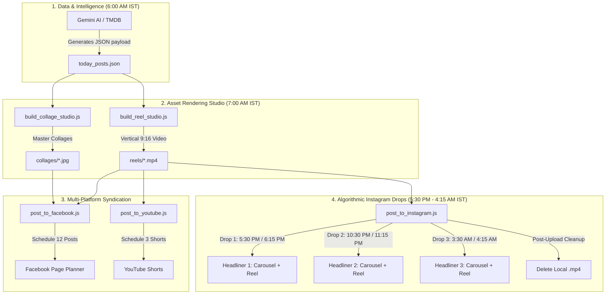

# 🌟 Born Today Hollywood — Autonomous Omnichannel Media Factory

> **100% Autonomous, Zero-Maintenance Viral Celebrity Birthday Content Factory**  
> Syndicating daily cinema tributes across **Facebook**, **Instagram**, **YouTube Shorts**, and **Threads** on complete autopilot.

[](https://github.com/aditya-Pratap15/birthday-auto-poster/actions/workflows/daily_post.yml)
[](https://github.com/aditya-Pratap15/birthday-auto-poster/actions/workflows/instagram_schedule.yml)
[](LICENSE)

---

## 📋 Table of Contents
1. [Executive Overview & Value Proposition](#1-executive-overview--value-proposition)
2. [Omnichannel Distribution Matrix](#2-omnichannel-distribution-matrix)
3. [End-to-End System Architecture](#3-end-to-end-system-architecture)
4. [Master Daily Publishing Timetable](#4-master-daily-publishing-timetable)
5. [Core Engine Components & Scripts](#5-core-engine-components--scripts)
6. [GitHub Secrets & Configuration](#6-github-secrets--configuration)
7. [Repository File Reference](#7-repository-file-reference)
8. [Operations, Monitoring & Manual Triggers](#8-operations-monitoring--manual-triggers)

---

## 1. Executive Overview & Value Proposition

**Born Today Hollywood** is an autonomous daily publishing machine built to celebrate cinema legends on their birthdays. Every single day, with **0 minutes of human intervention**, the pipeline:

1. **Discovers Celebrities:** Researches the **6 most famous Hollywood stars** born on the current calendar date using TMDB and Gemini AI.
2. **Generates Storytelling Assets:** Crafts high-retention trivia, viral teasers, career milestones, and pinned engagement questions.
3. **Builds Pixel-Perfect Collages:** Renders 1200×1200 master birthday collages with cinema-grade typography, dynamic era badges (Youth, Prime, Legend), and golden accents.
4. **Produces Vertical Reels:** Compiles 9:16 vertical video reels with AI neural voiceover narration, animated word-by-word karaoke captions, and ambient background music.
5. **Syndicates Across 4 Platforms:** Distributes content to Facebook, Instagram, YouTube Shorts, and Threads on an algorithmic schedule optimized for US peak engagement.
6. **Cleans Storage Automatically:** Purges heavy video files after successful uploads to maintain a lightweight, fast Git repository.

---

## 2. Omnichannel Distribution Matrix

| Platform | Channel / Page | Daily Volume | Formats Distributed | Scheduling Mechanism |
| :--- | :--- | :---: | :--- | :--- |
| **Facebook** | `Born Today Hollywood` (ID: `1345901645276194`) | **12 posts** | 6 Multi-Photo Albums (Collage + 5 Career Photos) + 6 Vertical Reels | Meta Planner API (Pre-scheduled across peak US hours) |
| **Instagram** | `@borntodayhollywood` (ID: `17841416842135384`) | **6 posts** | Top 3 Headliners: 3 Swipeable Carousels + 3 Vertical Reels | GitHub Actions Crons (Spaced out with 45m Photo/Reel offset) |
| **YouTube Shorts** | `Born Today Hollywood` (ID: `UC8te6ObjbEJe-878BMqOWYg`) | **3 Shorts** | Top 3 Headliners: 1080p Vertical Reels with Neural Voiceover | YouTube Data API v3 (Resumable Upload + publishAt schedule) |
| **Threads** | `@borntodayhollywood` (App ID: `4570968869850582`) | **3–6 posts** | Top 3 Headliners: Master Collage + Micro-trivia stories | Direct Threads Graph API (In setup / pending tester sync) |

---

## 3. End-to-End System Architecture



---

## 4. Master Daily Publishing Timetable

All times are aligned to **Tier 1 US Engagement Windows** (EDT) and converted to **IST**:

| Time (IST) | US Time (EDT) | Platform | Event / Action | Target Celebrity |
| :---: | :---: | :---: | :--- | :--- |
| **7:00 AM** | 9:30 PM (prev) | **Cloud Runner** | **Morning Creation Engine** (`daily_post.yml`) | All 6 Celebrities |
| **5:30 PM** | 8:00 AM | **Facebook & IG** | **US Morning Commute Drop:** FB Album #1 + IG Carousel #1 | **Headliner #1** |
| **6:15 PM** | 8:45 AM | **Facebook & IG** | **Morning Reel Drop:** FB Reel #1 + IG Reel #1 (+45m offset) | **Headliner #1** |
| **6:30 PM** | 9:00 AM | **YouTube** | **Short #1 Live** on YouTube Shorts feed | **Headliner #1** |
| **8:00 PM** | 10:30 AM | **Facebook** | FB Album #2 (US Mid-Morning Break) | **Headliner #2** |
| **8:45 PM** | 11:15 AM | **Facebook** | FB Reel #2 (+45m offset) | **Headliner #2** |
| **10:30 PM** | 1:00 PM | **Facebook & IG** | **US Lunchtime Drop:** FB Album #3 + IG Carousel #2 | **Headliner #2** |
| **11:15 PM** | 1:45 PM | **Facebook & IG** | **Lunch Reel Drop:** FB Reel #3 + IG Reel #2 (+45m offset) | **Headliner #2** |
| **11:30 PM** | 2:00 PM | **YouTube** | **Short #2 Live** on YouTube Shorts feed | **Headliner #2** |
| **1:00 AM (+1)** | 3:30 PM | **Facebook** | FB Album #4 (US Afternoon Lull) | Celebrity #4 |
| **1:45 AM (+1)** | 4:15 PM | **Facebook** | FB Reel #4 (+45m offset) | Celebrity #4 |
| **3:30 AM (+1)** | 6:00 PM | **Facebook & IG** | **US Evening Primetime Drop:** FB Album #5 + IG Carousel #3 | **Headliner #3** |
| **4:15 AM (+1)** | 6:45 PM | **Facebook & IG** | **Primetime Reel Drop:** FB Reel #5 + IG Reel #3 (+45m offset) | **Headliner #3** |
| **4:30 AM (+1)** | 7:00 PM | **YouTube** | **Short #3 Live** on YouTube Shorts feed | **Headliner #3** |
| **6:30 AM (+1)** | 9:00 PM | **Facebook** | FB Album #6 + Reel #6 (US Late Night Bedtime) | Celebrity #6 |

---

## 5. Core Engine Components & Scripts

### 1. `scripts/sync_daily_payload.js`
* Validates incoming daily payload or fetches birthdays directly from TMDB API.
* Generates balanced multi-photo arrays (Youth, Prime, Modern Legend) and peak engagement timestamps.

### 2. `scripts/build_collage_studio.js`
* Headless HTML5 Canvas engine rendering **1200×1200 high-res collages**.
* Applies dark-luxury styling, gold gradient banners, and viral teaser cards.

### 3. `scripts/build_reel_studio.js`
* Compiles **9:16 vertical video reels** (1080×1920).
* Integrates neural voiceover narration via edge-tts, generates dynamic word-by-word animated subtitles, and mixes ambient background music.

### 4. `scripts/post_to_facebook.js`
* Uploads Master Collage + 5 single career portraits as an unpublished batch, then publishes as a multi-photo album.
* Pre-schedules all 12 Facebook posts on Meta Business Suite Planner.
* Saves permanent Meta CDN photo URLs (`post.collage_cdn_url`) for downstream Instagram consumption.

### 5. `scripts/post_to_instagram.js`
* Dedicated Instagram publisher with smart auto-discovery (`--target <1|2|3|auto> --type <carousel|reel|auto>`).
* Handles swipeable multi-photo carousels and resumable video Reel uploads with 120s encoding polling.
* Automatically deletes local `.mp4` files upon successful upload.

### 6. `scripts/post_to_youtube.js`
* Connects via Google OAuth2 with automatic token refresh.
* Performs chunked resumable video uploads to YouTube Data API v3 and sets future `publishAt` timestamps.

---

## 6. GitHub Secrets & Configuration

To run this repository in your own environment, add these secrets to **Settings > Secrets and variables > Actions**:

| Secret Name | Description | Platform |
| :--- | :--- | :--- |
| `FB_PAGE_TOKEN_BORN_TODAY` | Long-lived Facebook Page Access Token with `instagram_content_publish` | Facebook & Instagram |
| `FB_PAGE_ID_BORN_TODAY` | Numeric Facebook Page ID (`1345901645276194`) | Facebook |
| `IG_USER_ID` | Numeric Instagram Business User ID (`17841416842135384`) | Instagram |
| `YOUTUBE_CLIENT_ID` | Google Cloud OAuth2 Client ID | YouTube Shorts |
| `YOUTUBE_CLIENT_SECRET` | Google Cloud OAuth2 Client Secret | YouTube Shorts |
| `YOUTUBE_REFRESH_TOKEN` | Permanent Google OAuth2 Refresh Token | YouTube Shorts |
| `TMDB_API_KEY` | The Movie Database (TMDB) API Key | Celebrity Photo Fetcher |

---

## 7. Repository File Reference

```
├── .github/
│   └── workflows/
│       ├── daily_post.yml            # 7:00 AM IST Creation & Facebook/YouTube Scheduler
│       └── instagram_schedule.yml    # Spaced-out Instagram Drops (6 crons/day)
├── backgrounds/
│   └── outro_background.png         # Luxury outro animated slide background
├── collage-maker/                    # Web-based visual design preview studio
├── collages/                         # Staging directory for generated collage images
├── presets/                          # Design layouts and color presets
├── reels/                            # Staging directory for generated vertical reels
├── scripts/
│   ├── build_collage_studio.js       # Master collage generator
│   ├── build_reel_studio.js          # Vertical reel compilation engine
│   ├── post_to_facebook.js           # Facebook album & reel scheduler
│   ├── post_to_instagram.js          # Dedicated Instagram publisher (45m offset)
│   ├── post_to_youtube.js            # YouTube Shorts resumable uploader
│   └── sync_daily_payload.js         # Daily celebrity birthday synchronizer
├── today_posts.json                  # Active database of current day's celebrities & logs
├── background_music.mp3              # Ambient background track for reels
├── page_logo.png                     # Official brand logo
└── Multi_Platform_Expansion_And_Automation_Master_Guide.md # Comprehensive operations blueprint
```

---

## 8. Operations, Monitoring & Manual Triggers

* **Automatic Daily Run:** Runs completely hands-free every morning at **7:00 AM IST (1:30 AM UTC)**.
* **Manual Override (All):** Go to GitHub Actions → Select **Daily Birthday Poster** → Click **Run workflow**.
* **Manual Instagram Drop:** Go to GitHub Actions → Select **Instagram Scheduled Auto Poster** → Choose target (`auto`, `1`, `2`, `3`) and action (`auto`, `carousel`, `reel`).
* **Logs & Auditing:** Check `today_posts.json` after each run to view published IDs for Facebook (`fb_post_id`, `fb_reel_id`), Instagram (`ig_post_id`, `ig_reel_id`), and YouTube (`youtube_video_id`).

---

*Crafted with precision for cinema fans worldwide by the Born Today Hollywood Team.*
